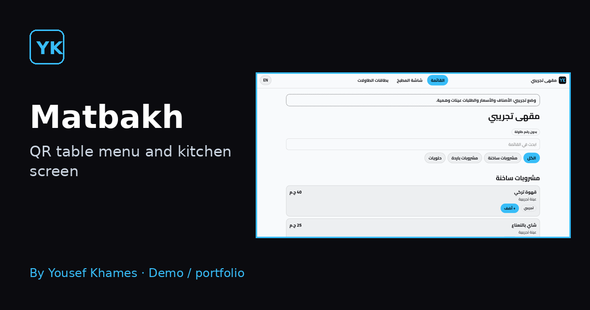

<div align="center">


# matbakh

**matbakh** · demo / portfolio project

**منيو QR وشاشة مطبخ** · مشروع تجريبي للعرض

[Live demo](https://yousefkhames.github.io/matbakh/) · By Yousef Khames · من تطوير يوسف خميس



</div>

---

# matbakh · مطبخ

A white-label QR table menu for cafes and restaurants: guests scan a table QR, build an order from the menu and open a WhatsApp draft; staff paste the order into a kitchen screen and move it from new to preparing, ready and served. Arabic RTL and English LTR. Static HTML, CSS and JavaScript; no build, account, API or payment processor.

<div lang="ar" dir="rtl">قائمة طعام بكود QR لكل طاولة. الضيف يجهّز طلبه ويفتح مسودة في واتساب، ثم يرسلها بنفسه. شاشة المطبخ تستورد الطلب من كوده. لا يوجد دفع داخل الأداة.</div>

 **By Yousef Khames · من تطوير يوسف خميس**

## Preview locally

```sh
python3 -m http.server 8080 --bind 127.0.0.1
```

Open `http://localhost:8080/#/t/5` (table 5), `#/kitchen` and `#/tables`. Everything in the sample is **demo content**: fictional items, fictional prices, orders tagged Demo. Screenshots in `docs/` use that demo data only.

## Set up a venue

1. Build the menu with the **menyu** kit builder (same menu schema), export `menu-data.js` and replace the file here. Or edit `menu-data.js` by hand.
2. Edit `config.js`: `whatsapp` (the public venue number), `tables` (number of QR cards), and set `demo: false` when the real menu and number are in. With no number the guest gets a **Copy order** button instead of a WhatsApp link.
3. Publish, open **Table cards**, paste the published link, test-scan with a phone, then print.
4. Theme: edit `assets/kit-theme.js` (`name`, `logo`, `accent`, `mode`, `light`, `dark`). Keep `assets/yk-logo.svg` and `assets/favicon.svg`.

## How an order travels

1. Guest scans table QR (`#/t/<n>`), adds items, taps **Prepare order in WhatsApp**. The message contains the items, table, menu total and an **order code** (`MB1.…`) that carries the cart.
2. WhatsApp opens a draft. **The guest must press send.** Opening a draft is not sending, and the order is not confirmed until the venue replies.
3. Staff copy the message from WhatsApp, paste it into **Kitchen screen** and import. The same order id imports only once. Item names come from this device's copy of the menu.
4. Tickets move through new → preparing → ready → served, with minutes since import shown from recorded timestamps.

## Deploy (GitHub Pages)

Create `yousefkhames/matbakh`, commit these files to `main`, Settings → Pages → Deploy from a branch → `main` / root. Live at `https://yousefkhames.github.io/matbakh/`. All paths are relative.

## Tests

```sh
npm run test:unit   # Node 22+, no install
npm run test:e2e    # headless Chrome as google-chrome
npm test
```

## Honest limits and privacy

- No server: orders do not arrive automatically. Someone must paste each order into the kitchen screen. This is a hand-off aid, not an order-management system.
- The kitchen board lives in one browser; it does not sync between screens and is erased if site data is cleared.
- Elapsed minutes count from the moment of import, not from when the guest ordered, and use the device clock.
- Prices shown are the menu prices on the guest device; the venue confirms the final amount. There is no payment, tip or tax handling.
- An order code can be edited by anyone who knows the format; staff should treat orders like any WhatsApp message and check item names.
- The app stores no customer name or phone number. The WhatsApp message goes through the guest's own WhatsApp account.
- Contrast of the default theme is checked; no blanket WCAG claim. Not tested on a real kitchen display.

## License

MIT, copyright Yousef Khames. See `LICENSE`. Cairo font: SIL OFL. `assets/qrcode.js`: qrcode-generator by Kazuhiko Arase (MIT, `assets/qrcode.LICENSE.txt`).
