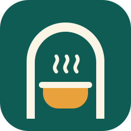
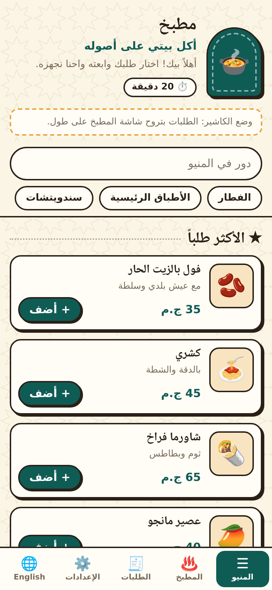
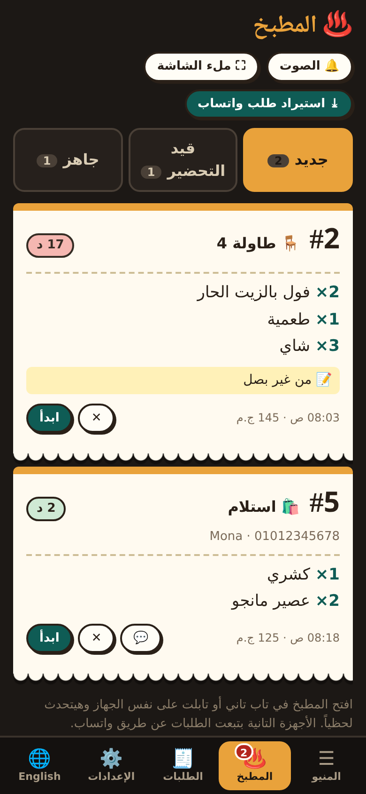
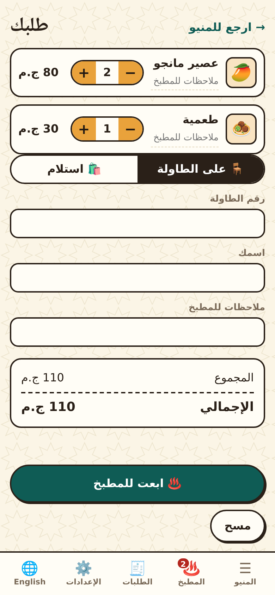
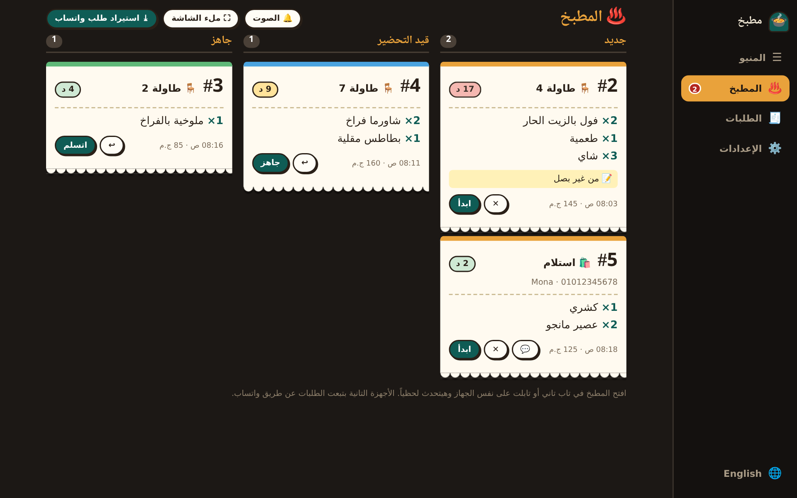
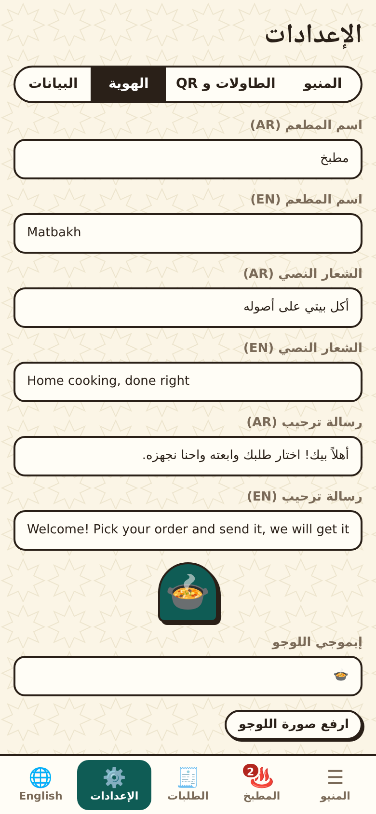
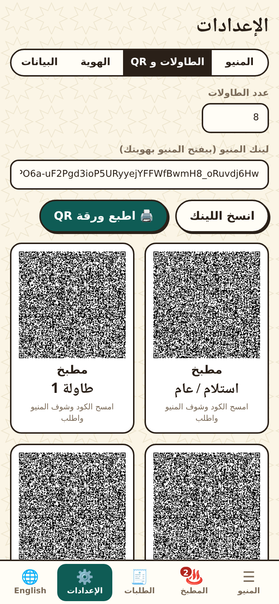
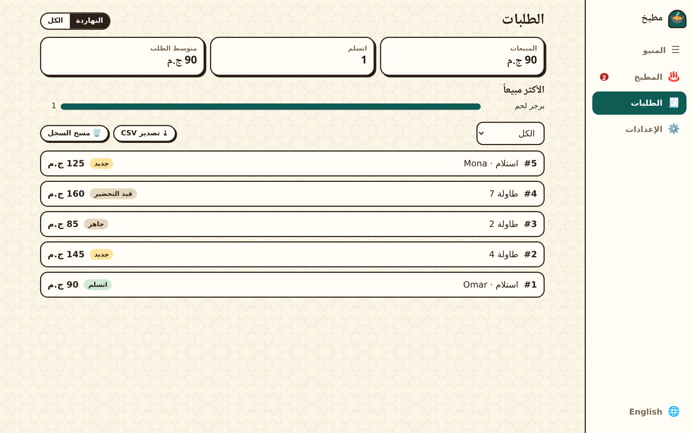

<p align="center"></p>

<h1 align="center">Matbakh | مطبخ</h1>

<p align="center"><b>A free, white-label QR menu, kitchen screen and WhatsApp ordering system for restaurants and cafes.</b><br>
Arabic and English, right-to-left ready, mobile first. No server, no sign-up, no monthly fee.</p>

<p align="center"><a href="https://yousefkhames.github.io/matbakh/"><b>Live demo → yousefkhames.github.io/matbakh</b></a></p>

<p align="center">  </p>

## The pitch

A small restaurant, cafe or bakery gets three things from one web page:

1. **A QR table menu.** Print a QR code per table. Customers scan it and see your menu, in your colors, with your logo, in Arabic or English. The menu travels inside the link, so no server is needed.
2. **A kitchen screen.** Orders show up as paper-style tickets in three columns: New, Preparing, Ready. Timers turn amber and red when an order waits too long. A bell rings on new orders.
3. **Pickup and WhatsApp orders.** A customer builds an order and taps one button. WhatsApp opens with the full order already written, addressed to your number. Paste that message into the kitchen screen and it becomes a ticket.

It is also **white-label**. Change the name, logo, colors, currency, language, tax, service charge and the whole menu in the Studio screen, then export it all as a JSON file and load it on another device. One codebase, many restaurants.

## Features

- Menu with categories, search, popular strip, sold-out switch, item emoji, bilingual names and descriptions
- Cart with per-item notes, table or pickup mode, name/phone validation, tax and service charge
- Order numbers that restart each day
- Kitchen board: New / Preparing / Ready, age timers, undo, cancel, sound, fullscreen, one-tap WhatsApp "your order is ready" to the customer
- Live sync between tabs of the same browser (open the kitchen on a tablet, take orders on the counter)
- Import a WhatsApp order message into the kitchen (duplicates are ignored)
- Orders page: today / all, sales, average order, top items, CSV export, printable receipts
- Studio: menu editor, tables and QR sheet (printable), brand editor, export/import, three starter templates (Egyptian cafe, fast food, bakery)
- Arabic and English with full RTL layout, optional Arabic-Indic digits
- Works offline after the first visit (network-first service worker)
- Keyboard and screen-reader friendly controls, reduced-motion support

<p align="center"></p>
<p align="center">  </p>

## How to use it

1. Open the [live app](https://yousefkhames.github.io/matbakh/) and go to **Studio**.
2. **Brand**: set the name, logo, colors, currency and your WhatsApp number (for example `01012345678`).
3. **Menu**: edit categories and items, or start from a template under **Data**.
4. **Tables & QR**: set the number of tables and print the QR sheet.
5. Keep **Kitchen** open on a tablet. Orders typed at the counter appear instantly. Orders that arrive on WhatsApp are pasted with **Import WhatsApp order**.

## Tech

Plain HTML, CSS and JavaScript. No framework, no build step, no backend.

- `js/core.js`: pure logic (money, totals, order codes, sanitizing, compression), unit tested in Node
- `js/app.js`: the UI, rendered with DOM calls and `textContent` (no `innerHTML` for user data)
- `localStorage` for data, `CompressionStream` for shareable menu links
- [qrcode-generator](https://github.com/kazuhikoarase/qrcode-generator) (MIT) for QR codes, vendored in `vendor/`

## Tests

```bash
npm test            # 15 unit tests (Node 18+)
npm i && npm run test:e2e   # real-browser click-through (needs Chrome; set CHROME=/path if not /usr/bin/google-chrome)
```

The end-to-end test starts a local server, drives Chrome through the owner flow, a separate "customer phone" profile opening a shared link, WhatsApp import, cross-tab sync, export/import and error cases, and fails on any console error. It can also run against the live site: `node tests/e2e.js https://yousefkhames.github.io/matbakh/`.

## Honest limits

- **No server means no shared database.** Your menu and orders live in the browser of the device you use. Clear the browser data and they are gone, so export a backup from Studio > Data now and then.
- **A customer's phone cannot write into your kitchen screen.** Customer orders reach you through WhatsApp. You paste the message into the kitchen screen to turn it into a ticket. Orders typed on the kitchen device itself, and tabs of the same browser, sync live.
- **WhatsApp is a link, not an API.** The app opens `wa.me` with the text filled in. The customer still has to press send. There is no delivery or read confirmation.
- **Shared menu links hold the whole menu.** The QR code gets denser as the menu grows. The demo menu (18 items) gives a link of about 1,900 characters. Around 40 items with long descriptions is the practical ceiling for one scannable QR code. The uploaded logo image is not included in shared links (the emoji or name is shown instead).
- **No online payments, no stock counting, no staff accounts or permissions.** Anyone with the owner device can open the Studio.
- Item pictures are emoji, not photos, to keep links small.
- Tested in Chrome. Needs a browser with `CompressionStream` (Chrome/Edge 80+, Safari 16.4+, Firefox 113+) to open shared links.

## License

MIT, see [LICENSE](LICENSE). QR code generation by Kazuhiko Arase, MIT.
